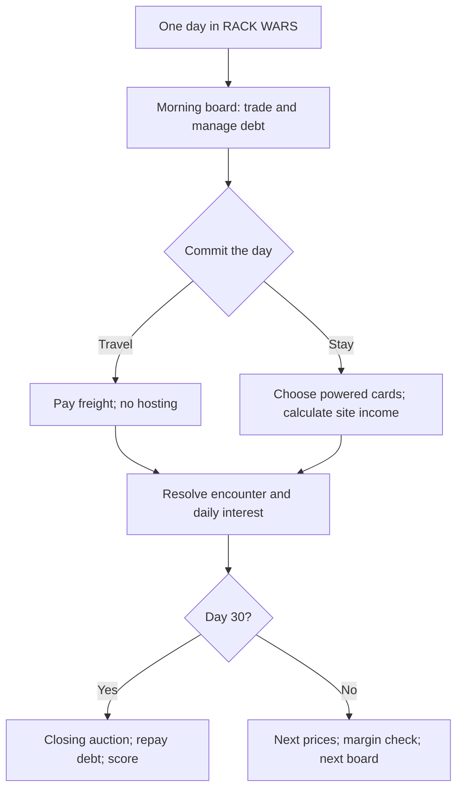

# RACK WARS

TUI implementation: [TUI-PLAN.md](TUI-PLAN.md). Phase checklist: [TUI-TASKS.md](TUI-TASKS.md).

**Drug Wars for GPUs. Buy distressed hardware, haul it between data-center markets, and get out before your lender owns the rack.**

Thirty days. Six kinds of GPU. Five markets. One increasingly polite creditor.

The coat fits anything; the site's racks do not. The neighborhoods are data-center towns. The product is compute hardware. Customs, utility inspectors, and a homeowners' group chat make moving it interesting. You can rent the cards while you hold them, but the money is in buying what everybody hates and selling what everybody suddenly needs.

`GPUs ARE OVER`, says the headline. Three days later, everybody needs a chatbot.

## Objective

Make a playable, replayable GPU trading game with the pace and pressure of Drug Wars, delivered as a native terminal user interface for macOS and Windows. The player should understand the board in seconds, make a consequential decision each day, and finish a run in roughly 10–15 minutes.

The main question is **what should I buy, where should I take it, and can I afford to wait?** Hosting, power, and satire support that question. This is not a facilities-management game or a model-training simulator.

This document is a design and build plan. All prices, rates, capacities, dates, and probabilities below are initial game-balance values, not real hardware specifications or verified economic results. The campaign compresses several years of AI headlines into a fictional month.

Success means a playable trading prototype proves that travel, inventory limits, debt, and price shocks are fun before the larger cast and hosting systems are added.

## The Drug Wars contract

| Drug Wars ingredient | RACK WARS equivalent |
|---|---|
| A short, finite run | Thirty days, then a forced cash-out and a score |
| Neighborhood price differences | GPU bids and asks in different data-center towns |
| A limited coat | A site's host racks, which cap what can run there at once |
| The loan shark | Shoreline Credit, compounding daily and calling collateral |
| Cheap product, sudden shortages | Crypto liquidation, export panic, model launches, obsolete flagships |
| Police encounters | Customs, serial checks, utility inspections, noise complaints |
| Coat and protection upgrades | Bigger leased sites, freight insurance, a generator, a lawyer |
| A lucky deal worth telling someone about | Buying the Merge dump, selling the shortage, getting out before CheapSeek |
| Another run with better judgment | Recognizable headline order, different prices and opportunities |

The player is a small operator trading a movable fleet, not a hyperscaler building permanent campuses. Changing towns moves the whole fleet and changes the active lease. There are no remote factories, shipping queues, or idle satellite sites to manage.

## Thirty-second rules

- You start on day 1 with **$30,000 cash, $20,000 debt, an empty garage, and 30 days** (net worth +$10,000 — the debt is the pressure, not the bank balance).
- Buy, sell, borrow, repay, and inspect the board without advancing time.
- End each day by **traveling** or **staying**. Stay to host, sit out a bad market, or cool down.
- Travel consumes one day in the first release. The fleet earns nothing in transit.
- Staying can earn hosting income, but rent, electricity, and debt interest still count.
- Every elapsed day compounds outstanding debt by **10%**, including travel days.
- Rack slots limit what a site can host, not what you can buy or carry. Power limits what you can switch on.
- Tomorrow's prices can make today's collateral insufficient. Shoreline acts before tomorrow's trading opens.
- After the day-30 action, sell everything at the displayed closing bids, settle the debt, and score the cash left over.

**A clean finish is a positive cash-out after all debt is paid.** A million dollars is a great score. Ten million is a neocloud. The game does not require a scripted jackpot to count as a win.

## How a run should feel

1. **Early:** scrape together profitable flips, resist filling the garage with the first thing you can afford, and notice how quickly interest compounds.
2. **Middle:** choose between paying down the note, moving to a larger site, or borrowing into an expensive shipment.
3. **Late:** unwind exposure before the next shock, or risk the whole fleet on one more spread.

Three approaches must remain viable: cautious trading with early repayment, freight arbitrage with little hosting, and a leveraged hosting-and-trading run. They should produce different risks, not three routes to the same prescribed inventory.

The result screen leads with the consequence:

```text
SOLD 4 H100s. TRADING PROFIT: $68,400.
```

```text
SHORELINE SOLD YOUR LAST 2 H100s. DEBT REMAINING: $28,000.
```

One large dollar line, with an expandable receipt underneath. The player should be able to explain a loss without opening a spreadsheet.

## The day

The morning board is a decision phase. Buying a card does not consume the day; neither does selling one or repaying the lender. Only the final **Travel** or **Stay** confirmation advances time. This rule applies everywhere.



### Resolution order

The implementation must use one authoritative order:

1. Lock the chosen action and its displayed costs. Reject an unaffordable action before commitment.
2. Resolve travel or the stay and calculate receipts and operating costs. Staying incurs that site's daily lease even with the GPUs off. Travel incurs freight instead of a site lease and cannot earn hosting income.
3. Resolve at most one encounter. Apply any selected response and show its receipt. A warned grid condition may affect hosting, but do not pile several random punishments onto one day.
4. Add hosting receipts, subtract operating charges, and accrue interest once: `interest = ceil(outstanding debt × 0.10)`. Cash charges that cannot be covered become additional debt before the credit check; interest applies after those charges are added.
5. If this was day 30, use the day-30 board's closing bids for the final auction. No day-31 interest, extra event, or hidden price reroll.
6. Otherwise, advance to the next day, apply its scheduled headline and seeded prices, resolve Shoreline's credit check, and open the new board. An uncured credit breach ends the run.

The initial board has no interest charge. The starter note costs $2,000 only after the first elapsed day if the player has not changed its balance.

The next committed action's random outcomes are already fixed in the save. Reloading an identical action does not reroll prices, customs, or a fire. A different choice may have a different outcome; reloading is not a slot machine.

## The board and the market

Use a fast, single-screen, keyboard-driven terminal interface, playable at 80 columns by 24 rows and responsive to terminal resizing. The implementation uses Go, Bubble Tea v2, and Lip Gloss v2 as described in [TUI-PLAN.md](TUI-PLAN.md). Mouse input is optional.

The board shows:

- Day, town, cash, debt, liquidation net worth, heat, fleet slots (what rides along), the site's host-rack capacity, and powered kW.
- One headline, its active effect, and any actionable warning about tomorrow.
- For each product: local **buy ask**, local **sell bid**, available stock, owned quantity, slots per unit, per-unit powered load, ordinary gross hosting per day, and class (consumer, enterprise, or modded).
- A compact holding detail: average acquisition price and profit/loss if sold here now, excluding past hosting income.
- A hosting strip and the net cost of staying or traveling.
- Buy, Sell, Lender, Travel, and Stay. Borrowing lives inside Lender; there is no second financial dashboard.

Quantity controls offer `1`, `5`, and `Max`, with a confirmation that shows cash and capacity afterward. Disable impossible actions and state the reason. Warnings must use text as well as color.

### Price rules

- Every product always has `0 < sell bid < buy ask`. Buying and immediately selling locally loses money.
- Initial pricing: `mid = base × town factor × headline factor × seeded daily variation`; `ask = ceil(mid × 1.10)` and `bid = floor(mid × 0.90)`. Clamp bids to at least $1 and asks above bids after rounding.
- Ordinary daily variation starts at `0.65–1.35×`. Named shocks may temporarily drive a product to `0.25–3.0×` its usual midpoint. Duration, affected products, and magnitude are explicit event data, not permanent multipliers accidentally stacked forever.
- Town advantages bias prices; they do not guarantee a profitable route every day. Initial town factors range from `0.8–1.2×`.
- Shops have finite stock, replenished only when the day advances. They buy any owned quantity at the posted bid in the first release. Do not add market depth or slippage yet.
- The current market's quotes are firm for the entire decision phase. Trading cannot refresh stock, advance headlines, or reroll prices.
- Other towns show your **last seen** quotes and their observation day. Never present an old quote as a guaranteed arrival price. A broad tip can say “cheap used cards in Texas” without revealing tomorrow's exact board.
- Favor useful, legible swings over realism. Multipliers are constrained so a temporary bad market cannot erase every affordable early-game opportunity.

Both sides of a trade must count freight and the day spent waiting. A large apparent spread is not automatically a profitable journey.

## The coat: six products

One unit is a game-sized, rack-ready bundle. Slots and power are abstractions; a slot is not a literal rack U. Buying is limited only by cash and shelf stock: the fleet can outgrow any site, and the whole fleet always travels (freight bills the footprint). Slots are a hosting contract: the cards switched on for the night must occupy no more than the site's slots, and only switched-on inventory draws power.

| Product | Base midpoint | Slots per unit | Powered load | Ordinary gross hosting/day | Trading personality |
|---|---:|---:|---:|---:|---|
| 3090 sled, four cards | $1,400 | 2 | 1.6 kW | $160 | Bulky crypto liquidation; cheap volume when small models take off |
| 4090 | $1,800 | 1 | 0.5 kW | $70 | Starter staple; liquid, useful, and occasionally smells like a connector |
| 4090-48 mod | $2,800 | 1 | 0.6 kW | $90 | Cheap memory; export and customs exposure; no universal best-card status |
| A100 | $9,000 | 1 | 0.6 kW | $180 | Older enterprise stock; steadier hosting, vulnerable to the next flagship |
| H100 | $32,000 | 1 | 0.9 kW | $350 | The boss purchase; allocation spreads, expensive collateral, violent repricing |
| MI300 | $12,000 | 2 | 1.0 kW | $250 | Alternative supplier; attractive discounts and a clearly priced software risk |

“A $350 3090” means one card inside a four-card sled; the normal sled midpoint is $1,400. Four sleds already fill the garage's eight host racks for about $5,600 before spreads or shocks — a fifth sled is a legal purchase, it just switches off and rides along. The Merge can make them much cheaper. Use bundle prices consistently in the UI and event copy.

The mystery pallet is an encounter, not a seventh commodity or a core product with undefined capacity. Bees remain an optional joke for later.

### Capacity and power

- You can buy, carry, and resell any amount of unpowered hardware. Neither an overloaded breaker nor an over-subscribed rack ever blocks a trade; slots fence hosting, nothing else.
- The hosting screen defaults to the best-paying valid powered subset under both the meter and the site's slots. The player may change it but should not have to solve a packing puzzle every turn.
- Show `powered load / available kW` and `hosted slots / site slots` before confirmation. Block an unsafe load and an over-full rack; a routine click cannot silently zero the night.
- Bigger sites improve hosting capacity and power, not the intrinsic price of a card. Nothing about the active lease limits what you may own.
- The fleet always travels whole: arriving at a smaller site is never blocked, though the destination hosts only its own racks' worth, and freight still bills `route fee + $50 × fleet slots`. The travel preview shows the fleet footprint and the destination's host capacity; there is no hidden storage penalty.

## The towns

Start with three markets; expand to five after the trading prototype works. The garage is the home market, not an extra town layered underneath every destination.

| Market | Host racks / power | Daily lease | Why go there? | What bites? |
|---|---|---:|---|---|
| The garage | 8 slots / 2 kW | $0 | Free base; ordinary consumer-card trading | Denise's group chat; little hosting capacity |
| Ashburn | 16 slots / 12 kW | $800 | Enterprise buyers, H100 allocations, premium contracts | High fixed costs and serial checks |
| West Texas | 24 slots / 10 kW | $250 | Crypto liquidation and bulk used inventory | Curtailment; more slots than dependable power |
| The Dalles | 16 slots / 8 kW | $350 | Cheap electricity and steady older enterprise stock | Drought reduces available power for a stated window |
| Huaqiangbei | No hosting site | $100 | Modded cards, low asks, risky arbitrage | Customs on departure; scarce enterprise buyers |

All routes initially take **one day**. Freight is `a route fee + $50 × fleet slots` — the footprint that rides the truck, powered or not — shown before confirming. Start route fees at $250 for domestic travel and $1,000 for any route involving Huaqiangbei. An empty departure from the garage costs $250, not thousands of dollars before the player can trade.

Travel forecasts show the next destination's lease, host-rack capacity, power condition, current known market information, freight cost, and estimated interest. Arriving does not automatically charge another day's rent.

Two-day international freight, Memphis, and a purchased turbine are expansion candidates. They do not belong in the first playable economy.

## Shoreline Credit

**“We believe in the long-term value of your collateral.”**

One visible debt balance. One daily rate. Repay any amount during the morning, free of time cost. New borrowing is cash immediately and is bounded by a visible credit ceiling:

```text
collateral value = sum(owned units × current local sell bid)
credit ceiling   = $30,000 + floor(0.50 × collateral value)
available credit = max(0, credit ceiling - outstanding debt)
```

The $30,000 unsecured floor gives the $20,000 starter note room to breathe. It is a fixed allowance, not a second account, free cash, or daily income. Interest can push the debt above the ceiling.

Selling reduces collateral and may reduce your limit. The sale confirmation routes enough proceeds to Shoreline to keep the loan compliant before releasing the remaining cash. Show this split before the player confirms. Recalculate headroom after every transaction; free morning trades cannot bypass the covenant.

At the next morning's check, Shoreline compares the debt with **the new bids**, before the player can trade. If the debt exceeds the ceiling:

1. Use cash to repay the amount needed to cure the breach, or all cash if that is insufficient.
2. If still in breach, sell whole inventory units at the displayed bid, highest bid per unit first, with product order breaking ties. Apply proceeds to the outstanding debt, return any surplus to cash, and recalculate the smaller collateral base after each sale. Debt cannot become negative.
3. Stop as soon as compliant. If no cash or GPUs remain and debt still exceeds $30,000, the run ends in repossession.

Do not treat selling collateral as if the original borrowing limit stayed unchanged. Show the before-and-after figures in the lender receipt.

**Worked shock:** at the check, you owe $60,000, have no cash, and own two H100s. Yesterday's $40,000 bids supported a $70,000 ceiling. CheapSeek takes each bid to $16,000, cutting the ceiling to $46,000. Selling one leaves $44,000 debt against a $38,000 ceiling, so Shoreline sells both. You keep no H100s and owe $28,000. The run can continue, but breakfast is ruined.

The lender panel always shows current headroom, tomorrow's interest at the current balance, and a stress preview using a 50% fall in collateral bids. Paying down the note on rumor day must be a real defensive choice.

Negative net worth does not end a run. An uncured credit breach does. No additional secret bankruptcy rule.

## Hosting: a reason to hold, not the whole game

Staying offers **Host** or **Power off**. Both spend the day and pay the site lease. There is one featured workload, not six simultaneous customers to optimize.

```text
net site income = eligible powered units' gross receipts
                  - lease - electricity - chosen mitigation costs
electricity     = powered kW × 24 × local $/kWh
```

Base gross receipts are in the product table. Local electricity starts between $0.08 and $0.35/kWh and is always displayed. Idle stored cards draw no power. Debt interest is shown separately and included in the day's total cash/debt preview.

On ordinary days every product can serve the generic workload. A featured workload temporarily changes eligibility or payout. Cards that do not qualify can still be stored or traded. Do not introduce tokens, model weights, utilization sliders, cooling loops, or maintenance staff as separate player-managed resources.

| Featured workload | Effect | The decision |
|---|---|---|
| Chatbot rush | All cards earn 2× ordinary gross for two nights | Host tonight or sell into the rush? |
| Strawberry | 4090-48, A100, H100, and MI300 earn 3× ordinary gross for two nights; other cards earn ordinary rates | Is the premium worth buying expensive memory and delaying a sale? |
| CheapSeek | 3090 sleds, 4090s, and 4090-48s earn 3× ordinary gross for two nights; enterprise cards earn 0.5× | Pivot into cheap volume or buy the enterprise crash? |
| Sonnet | Operators below 60 heat earn 1.25× ordinary gross for a stated two-night window | Stay clean or accept the riskier shipment? |

No flat $2,000,000 service bonus or $5,000,000 volume crown in the base game. Those payouts would decide the entire run and make ordinary trading decorative. Optional challenge contracts can be added only after they have capacity requirements, visible deadlines, and rewards that do not overwhelm the trade economy.

Overclocking is a later single toggle: more hosting income, more clearly disclosed failure risk. It must never be required to finish successfully. Hardware destruction, ROCm failures, and safety gear enter together after ordinary hosting is balanced.

## Heat and encounters

One visible meter, `0–100`. No separate provenance, police, reputation, and zoning currencies.

- Buying a 4090-48 unit adds 10 heat; a shipment confirmation shows the total before purchase, capped at 100.
- A quiet stay with the GPUs off removes 10 heat. An ordinary, incident-free hosting stay removes 5. Travel does not cool the meter.
- At 60 heat, clean premium contracts and new allocation deals are unavailable. Normal buying and selling remain open, so a penalty cannot trap the player in an unusable town.
- A customs check is possible when leaving Huaqiangbei with GPUs: start at a 5% chance below 60 heat and 25% at or above it. Empty fleets are exempt. The travel confirmation shows the applicable risk.
- Each flagged shipment risks one encounter, not one roll per card. Other random encounters share the daily one-encounter limit.

An encounter is a short choice with visible stakes: pay a fine, surrender one named unit, or contest the check at a stated chance of success. A contested loss cannot confiscate more than the amount disclosed. If a cash option is unaffordable, disable it; always retain at least one legal response. No mandatory combat minigame.

Severe system-wide shocks get a warning one decision phase before they resolve. At most one major market shock can begin on a given day; events cannot silently stack an outage, a seizure, and a fire on the same shipment. Random losses should normally be bounded to part of the fleet. Choosing extreme leverage can still turn a bounded loss into insolvency.

## The headline campaign

Keep the recognizable arc. Vary the opportunity.

| Day | Headline | Mechanical role |
|---|---|---|
| 1–2 | Crypto looks tired; used-card listings pile up | Affordable trades, a readable starter market, a warning before the dump |
| 3 | **THE MERGE: GPUs ARE OVER** | 3090 sled prices fall sharply, especially in Texas |
| 6 | **CHATBOT NEEDS EVERY CARD YOU JUST SOLD** | Consumer demand rebounds; generic hosting rush |
| 10 | **ALLOCATION ANDY IS SUPPLY CONSTRAINED** | Enterprise scarcity; a limited H100 allocation may be offered |
| 12 | **EXPORT RULES UPDATED WHILE YOUR FLIGHT WAS BOARDING** | Modded-card spread and customs exposure become more tempting |
| 14 | **SAM IS OUT. SAM IS BACK. YOUR INVOICE IS UNDER REVIEW.** | Temporary hosting disruption; a clearly capped clawback if you took the affected contract |
| 18 | **STRAWBERRY THINKS LONGER. YOUR METER DOES TOO.** | Short memory-heavy hosting premium and resale demand |
| 21 | **THE GRID WOULD LIKE YOU TO STOP** | A warned regional power constraint; a disclosed curtailment offer may beat hosting |
| 24 | **STARGATE ANNOUNCES $500,000,000,000** | Customers hesitate; enterprise hosting softens. Their big number appears beside yours |
| 25 | **HANGZHOU HAS A SMALL MODEL AND A LARGE RUMOR** | Explicit warning that enterprise collateral and rental rates may fall tomorrow |
| 26 | **CHEAPSEEK MONDAY** | Enterprise repricing, lender check, cheap-card volume demand |
| 29 | **THE MORE YOU BUY, THE MORE YOU SAVE** | Final keynote reprices older enterprise cards; show the effect before the last decision |
| 30 | **LAST CALL FOR YOUR LITTLE CLOUD** | One last trade-and-action phase, closing auction, final score |

These are campaign anchors, not a claim about real chronology. The prior morning's board previews each major upcoming shock in plain language; day 1 can warn about the early used-card trend. Rumor copy must describe the risk, not merely contain an obscure industry reference.

The seed varies town inventories, daily prices, shock magnitudes, eligible contract offers, and bounded encounter outcomes. The major headline order stays learnable. A familiar event should help a returning player make a better decision without guaranteeing that the same shopping list wins every run.

On the same seed, a strategy is reproducible. Across seeds, no card should dominate trading profit, hosting efficiency, capacity, and risk simultaneously. A 4090-48 can bridge two workloads, but its customs risk, heat, limited stock, and price must make that an opportunity rather than the solved answer.

Offer a daily shared seed only after local runs are stable. Alternate calendars and endless play are later modes, not solutions for a weak 30-day campaign.

## The people and the jokes

Keep the satire in headlines, offers, and receipts. The player should understand every mechanical consequence without recognizing the reference.

| Person or institution | Role in play |
|---|---|
| **Nvidya / Jensen Hwan** | Keynotes and the promise that this generation will never depreciate |
| **Allocation Andy** | Limited H100 stock below street ask, conditional on low heat; an optional jacket can help later |
| **AyyMD / Lisa Soo** | MI300 discounts and “fine wine”; software reliability becomes a disclosed event, not an unexplained zero |
| **ClosedAI / Sam Saltman** | A demand boom, a board weekend, an invoice clarification |
| **Anthropiq / Dario Modei** | A long constitution attached to an otherwise correct payment |
| **Elon Husk** | “Colossus 7,” a zoning problem, and eventually a dangerous offer paid partly in stock |
| **CheapSeek** | Small-model demand and a very large collateral problem |
| **Zuck** | A cluster photo captioned `llama`; a one-day consumer-card price spike |
| **Shoreline Credit** | Polite emails, daily interest, the keys to the rack |
| **Denise** | Garage noise warnings that arrive in the same thread as a lost cat |

Examples of short resolution copy:

- `GPUs are over.` The used-card aisle is full.
- `Supply constrained.` Andy has four, for a price.
- `Your invoice has been clarified.` The receipt shows exactly what was clawed back.
- `ERCOT: turn off and we will send $8,000.` The player can compare that with tonight's net hosting.
- `We sold the collateral. Have a nice morning.`
- `The transformer arrives in 2029.` An expansion offer, not a surprise rule that strands a paid-for fleet.
- `A squirrel.` The warning and mitigation stay readable even if the player skips the joke.

API-credit buyouts, Husk stock, a reactor, Memphis, Kyle the ROCm fixer, bees, generators, lawyers, and the financing button are a content backlog. Add one only when its decision improves the core loop. Do not make them prerequisites for a good ending.

## A morning

Illustrative local board; the “Buy” column is always above “Sell.”

```text
DAY 25 / 30       WEST TEXAS          HEAT 30 / 100
CASH $14,000      DEBT $60,000        LIQUIDATION NET $34,000
FLEET 4 slots     HOSTS 2 / 24      POWERED 1.8 / 10 kW

HEADLINE: A small model out of Hangzhou. A large rumor.
TOMORROW: Enterprise resale and hosting rates may fall sharply.
LENDER: Ceiling $70,000. Tomorrow's interest: $6,000.

PRODUCT          BUY ASK    SELL BID   STOCK   OWNED
3090 sled           $770        $630      12       0
4090              $1,980      $1,620       6       0
4090-48           $3,080      $2,520       2       0
A100              $9,900      $8,100       2       0
H100             $48,890     $40,000       1       2
MI300            $13,200     $10,800       2       0

STAY: Host $700 - lease $250 - power $5 = about +$445 cash
      Debt grows $6,000 if you keep the current balance.
TRAVEL: Choose destination for an exact quote. No hosting.

[B]uy  [S]ell  [L]ender  [T]ravel  [E]nd day / Stay
```

Net worth is `cash + local sell value - debt`, excluding any future hosting income. Here it is `$14,000 + $80,000 - $60,000 = $34,000`. The decision is visible: repay, sell before the rumor resolves, move, or hold. The game does not select the bad answer for the player.

## Endings and replay

At the day-30 close, liquidate at the displayed bids, apply all cash to debt, and show the remainder or deficiency. Do not score asks, purchase prices, future contract revenue, or unsellable promises.

| Result | Ending |
|---|---|
| Debt settled, positive cash-out | **Still independent.** You got out with money |
| At least $100,000 cash-out | **Garage graduate.** Denise is cautiously pleased |
| At least $1,000,000 cash-out | **Regional problem.** The county knows your name |
| At least $10,000,000 cash-out | **Neocloud.** Ashburn has not heard of you yet |
| Debt settled, exactly $0 | **Walked away.** No money, no creditor |
| Deficiency at the close or uncured credit breach | **Shoreline's new subsidiary.** Your rack is a line item |

Award the highest qualifying cash-out rank. These are provisional score ranks, not claims that the economy already supports them. Calibrate them after complete runs exist. A $100,000,000 screenshot can be a stretch target; do not inflate payouts just to manufacture it.

The end screen shows final cash-out, peak net worth, interest paid, best flip, forced-sale losses, seed, and a one-sentence epitaph. Include **Replay this seed** and **New run**. Restart should take one key selection and no lengthy tutorial.

## Procedure

Follow the seven implementation phases in [TUI-PLAN.md](TUI-PLAN.md), tracking execution in [TUI-TASKS.md](TUI-TASKS.md). This file remains the authority for game rules and balance targets; the TUI plan defines code boundaries, platform behavior, and delivery gates.

| Phase | Result | Evidence required to continue |
|---|---|---|
| 1 — Terminal foundation | Go/Bubble Tea shell on Mac and Windows | Keyboard, resize, minimum layout, and terminal restoration checks |
| 2 — Trading engine | Deterministic 30-day rules with three markets and three products | Winning trade-only trace, warned liquidation, and rule tests |
| 3 — Playable trading TUI | Full keyboard-only trading prototype | Complete a run and replay on both primary operating systems |
| 4 — Persistence and replay | Versioned local saves and reproducible traces | Resume equivalence, backup recovery, and tested paths on both systems |
| 5 — Full GPU game | Five markets, six products, hosting, power, heat, and encounters | Successful cautious, hosting, and import runs under the same rules |
| 6 — Balance and hardening | Readable, replayable release candidate | The mechanical, balance, player, and terminal checks below and in the TUI plan |
| 7 — Native distribution | Mac and Windows release archives | Extracted builds run offline without Go; save/resume works on target systems |

The prototype uses garage/Ashburn/West Texas and 3090 sled/4090/H100. Hosting, electricity, heat, encounters, allocations, and operating leases stay disabled until the trading loop passes. Freight, capacity, debt, and the full 30-day close remain real.

One implementer can build these phases sequentially, with design review and platform testing at the named gates. No backend, accounts, multiplayer, live market data, or real-money economy is needed. Optional jokes and systems come after the base gates pass, one clear decision at a time.

## Stopping Conditions

- **Planning complete:** this document fixes the game rules; the linked TUI plan fixes platform targets, implementation phases, and delivery gates. Implementation and balance remain unverified until built.
- **Prototype complete:** TUI Phases 1–3 pass with recorded action traces and a playable 30-day loop on both primary operating systems. Do not call a headline animation or a guaranteed winning script a prototype pass.
- **Core ready:** TUI Phases 4–6 pass the save, mechanical, balance, player, and terminal checks. Phase 7 establishes distributable artifacts; optional content cannot delay a satisfying base game.
- **Rework rule:** after two unsuccessful balance passes on the same gate, name the broken assumption and change the relevant rule or parameter family before another pass. Do not repeatedly add bonuses or quietly lower the acceptance bar.
- **Escalation:** if trade-only survival and 10% daily interest cannot coexist under reasonable, readable price swings, the designer must explicitly revisit the interest rate or starter debt. Preserve the debt-pressure experience; do not hide compounding or subsidize every run with a mandatory contract.

## Procedure Risks

| Risk | Response |
|---|---|
| Hosting turns this into a data-center spreadsheet | Ship trade-only first; keep one workload and automatic valid power selection |
| The fixed campaign produces one solved shopping list | Vary stock, prices, and shock strength; compare strategies across seeds |
| A 10% note kills every reasonable first run | Make early repayment possible, show interest clearly, and measure complete trajectories before tuning |
| A margin call feels like stolen agency | Warn before major repricing, expose the credit formula, and itemize automatic sales |
| Same-town or borrow/buy loops create free money | Enforce bid below ask, finite stock, action-free quotes that never refresh, and recomputed collateral after every transaction |
| The player cannot afford travel after a bad trade | Keep the free garage usable, allow partial sales and repayment, and show freight before purchases |
| Large bonus checks make the market irrelevant | Remove fixed jackpots; tie income to actual capacity and elapsed days |
| Satire hides important rules | Pair every joke with explicit price, eligibility, duration, and dollar consequences |
| Optional currencies and sites consume the build | Keep stock, API credits, remote campuses, and two-day transit out until core gates pass |

## Evaluation

These are proposed acceptance checks. No implementation, simulation, or playtest has been run for this document.

### Mechanical checks

The implementer should cover the state transitions where money, time, and ownership can be created or lost:

- Buying, selling, and repayment consume no days; each Stay or Travel consumes exactly one. A full run has 30 commitments and no day-31 charge.
- A same-town round trip loses the bid/ask spread. Trading cannot refill stock. Cash and quantities cannot go negative through a normal transaction.
- Borrowing never exceeds the recalculated ceiling. A borrow/buy/resell loop cannot create net worth. Repayment immediately changes the interest preview.
- Interest compounds once per elapsed day. If nothing changes the balance, the untouched $20,000 note becomes $22,000 after the first day and $24,200 after the second.
- The worked two-H100 shock produces two forced sales and $28,000 debt at the stated check. Test partial cash cures, whole-unit surplus returned to cash, no remaining collateral, and the shrinking credit ceiling.
- Stored GPUs count toward the fleet's freight footprint but not toward power; the fleet always travels whole and no site blocks its arrival. Only the hosted subset must fit the site's slots and meter. Transit earns zero hosting revenue and does not also charge a site lease.
- A disabled or ineligible card cannot earn a featured payout. Operating receipts, costs, event losses, and debt charges reconcile to the displayed receipt.
- A saved run resumed before a commitment produces the same result as uninterrupted play with the same actions. Save version mismatches fail clearly rather than silently resetting debt or stock.
- Final cash-out equals closing cash plus closing bids times owned quantities minus debt, with any deficiency shown. The ending tier uses that result.

### Balance checks

Begin with a fixed suite of 20 recorded seeds and three simple benchmark policies: trade and repay early; buy low and hold; borrow toward a headline opportunity. These policies are diagnostics, not proof of the optimal strategy.

Record final cash-out, failure day, interest paid, trade profit, hosting net income, largest position, and forced-sale losses. Compare identical seeds after each balance change.

Initial targets:

- Successful finishes must exist on at least 15 of the 20 seeds using a documented policy or human action trace, rather than a claim that a hidden winning route exists.
- Trading with early repayment succeeds on at least 10 seeds. It need not reach the highest rank.
- High leverage has a higher upside and a visibly worse failure rate than early repayment. Merely holding the most expensive card is not the best policy on every seed.
- On successful trading-policy runs, realized trade profit exceeds net hosting income. The trade-only prototype must demonstrate that hosting is optional for survival.
- No one product is the best choice in every seed and every headline window. Review suspicious dominance in stock, capacity, and risk before adding content.

These targets are starting acceptance criteria. Change them explicitly, with the observed reason, if testing reveals a better difficulty target.

### Player checks

Observe five first-time players without coaching beyond the in-game introduction. For a release candidate:

- At least four can explain buy versus sell, what advances the day, and the debt cost by their third commitment.
- At least four can identify a displayed defensive action before CheapSeek hits; they may still choose greed.
- Typical completed runs take about 10–15 minutes. Routine trading does not require a calculator or reading every joke.
- At least three voluntarily start another run and can name something they will do differently.
- At least three can recount a particular trade, escape, or loss rather than only the final number.

That is the test: **“I bought the cards nobody wanted, nearly lost the rack, and I know what I'll do next time.”**
