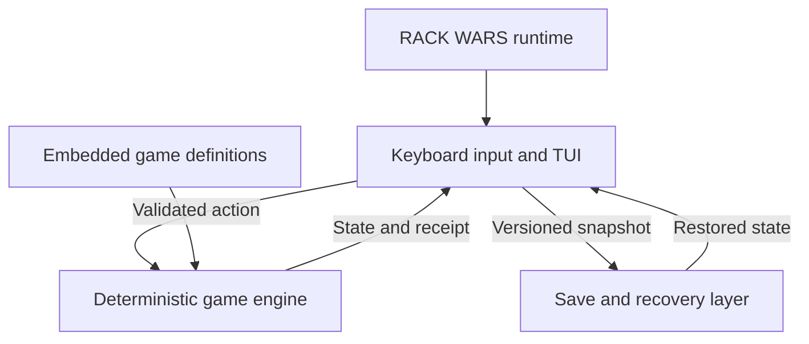

# RACK WARS — Cross-platform TUI implementation plan

Game design: [RACK-WARS.md](RACK-WARS.md). Execution checklist: [TUI-TASKS.md](TUI-TASKS.md).

Status: planned; implementation has not started. This plan authorizes no assumption that a build, test, playtest, or release has already happened.

## Objective

Build RACK WARS as an offline, keyboard-driven terminal game that runs natively on macOS and Windows. Preserve the 30-day Drug Wars loop: trade GPUs, move between markets, manage inventory and debt, survive price shocks, and cash out.

Players download an executable and run it in a terminal. They do not need Go, Python, Node, Docker, WSL, a browser, an account, or an internet connection to play. Developers use Go to build the game.

Deliver the trading prototype first, then persistence, the full GPU-specific rules, terminal polish, and distributable builds. This is an implementation plan; its acceptance checks remain proposed until executed.

## Technical decisions

| Area | Decision |
|---|---|
| Language | Go; choose a supported stable toolchain compatible with the selected dependencies in Phase 1, then pin it in development and CI |
| TUI | Bubble Tea v2 for input, state updates, terminal lifecycle, and rendering |
| Styling | Lip Gloss v2; use Bubbles v2 widgets only where they simplify inputs, help, or scrolling |
| Packaging | One executable per OS/architecture, with game data embedded; target `CGO_ENABLED=0` |
| Rules | A deterministic Go engine with no terminal or filesystem dependencies |
| Content | Embedded, versioned product, town, workload, and event definitions |
| Persistence | Local versioned JSON saves, a last-good backup, and action traces for reproduction |
| Testing | Go tests for rules and persistence, TUI input/render checks, and interactive testing on both operating systems |
| Distribution | Downloadable archives first; package managers and installers can follow |

Use the v2 module paths `charm.land/bubbletea/v2` and `charm.land/lipgloss/v2`. Follow the current v2 APIs rather than copying v1 terminal setup examples. The framework's official [README](https://github.com/charmbracelet/bubbletea) and [v2 upgrade guide](https://github.com/charmbracelet/bubbletea/blob/main/UPGRADE_GUIDE_V2.md) document the model/update/view pattern and module paths. Pin exact dependency versions in `go.mod` and `go.sum` once the initial platform spike passes.

Go supports selecting target platforms with `GOOS` and `GOARCH`; see the [Go cross-compilation documentation](https://go.dev/doc/faq#cross-compile). Cross-compilation produces a candidate artifact, not evidence that terminal input and rendering work on that platform.

### Platform targets

| Target | Required artifact | Interactive acceptance environment |
|---|---|---|
| Apple Silicon Mac | `darwin/arm64` executable | macOS Terminal.app; also check iTerm2 |
| Intel Mac | `darwin/amd64` executable | Terminal.app on an Intel Mac or an explicitly documented compatible execution environment |
| Windows PC | `windows/amd64` `.exe` | Windows 11, Windows Terminal, PowerShell |
| Windows on ARM | Optional `windows/arm64` `.exe` | Claim support only after an interactive test on ARM Windows |

Record the minimum supported OS versions in Phase 1 using the pinned toolchain's requirements. Test Windows 10 separately before claiming support. Linux is a possible later build, not a requirement for this release.

## Terminal experience

The market board is the main screen. Use short overlays for quantity entry, travel, lender actions, encounters, help, receipts, and the ending. Keep decisions visible; avoid a deep hierarchy of menus.

| Input | Behavior |
|---|---|
| Arrow keys or `j` / `k` | Select a product or menu row |
| `b` / `s` | Buy or sell the selected product |
| `l` | Open lender: borrow, repay, headroom, and stress preview |
| `t` | Choose a destination and inspect freight, capacity, and risk |
| `e` | Open Stay: hosting or power off, followed by confirmation |
| Enter | Accept the selected choice; committing a day requires an explicit confirmation |
| Esc | Cancel the current overlay without changing the game |
| `?` | Show contextual help |
| `q` / Ctrl+C | Save and quit through the same orderly shutdown path |

When a quantity field has focus, numbers are input rather than global shortcuts. Never let key repeat or a queued Enter commit two days. A pending encounter must be resolved or saved as pending; quitting cannot skip its consequence.

### Layout and compatibility

- **Minimum playable size: 80 columns × 24 rows.** Keep cash, debt, headline, market rows, and action hints visible. Put secondary details in a scrollable receipt or help overlay.
- At wider sizes, add a side panel for inventory details, lender exposure, and travel information. At smaller sizes, show a resize message while preserving the run; resizing never advances time.
- Keyboard operation is complete. Mouse input is optional and comes after keyboard acceptance.
- Use ordinary monospace text and terminal colors. Do not require emoji, a Nerd Font, images, true color, or special keyboard protocols.
- Provide `--no-color` and `--ascii`; honor `NO_COLOR`. Represent heat and warnings with text or numbers as well as color.
- Measure terminal cell width, not byte length. Wrap or truncate headlines without breaking columns or hiding important costs.
- Restore the cursor, input mode, and alternate screen on normal quit and handled errors. Write debug logs to a file, not over the game board.
- Non-interactive input/output should produce a short launch instruction and an error exit, rather than entering a broken full-screen mode. `--help` and `--version` remain usable without a TTY.

## Code boundaries

Start with a small structure; create packages when the relevant phase needs them:

```text
cmd/rackwars/          entry point and CLI options
internal/game/        state, actions, prices, interest, turn resolution, scoring
internal/content/     embedded definitions and validation
internal/tui/         Bubble Tea model, screens, key bindings, presentation
internal/save/        paths, save versions, backup/recovery, file replacement
internal/sim/         headless action traces and balance policies
testdata/             known seeds, action traces, save fixtures, render fixtures
.github/workflows/    platform checks and candidate release builds
```

The TUI sends validated actions to the engine and renders returned state and receipts. Only the engine changes money, inventory, debt, day, or event outcomes. Rendering, resizing, help, and cursor movement must not consume randomness or game time.



Use integer money and power units. Start with whole-dollar `int64` money, integer watts, and fixed-point price/rate calculations. Round electricity charges to the nearest dollar, ties up; round interest upward as the game design specifies. Document rounding once and apply it identically in previews, settlement, tests, and saves.

Store the seed, a versioned reproducible random generator state or stable random counter, and pending outcomes. Do not rely on wall-clock time after choosing the run seed, map iteration order, or the machine's locale. Sort collections whenever ordering affects outcomes. Record both engine/content version and seed so a replay does not silently pretend to reproduce an older ruleset.

## Procedure

One implementer can execute these phases sequentially, with design review at the economy gates and platform testers for terminal checks. Each phase names its inputs, deliverable, and evidence required to continue. Estimates are intentionally omitted until the initial platform spike establishes the toolchain and terminal constraints.

### Phase 1 — Prove the terminal foundation

**Owner:** implementer. **Inputs:** this plan and the platform targets.

1. Initialize the Go module, pin compatible stable dependencies, and record build/run commands for PowerShell and a macOS shell.
2. Build a minimal full-screen TUI showing a title, sample market rows, selection, one overlay, help, resize handling, and orderly exit.
3. Establish 80×24 and wide layouts, ASCII and no-color modes, and a non-TTY error path.
4. Run it interactively on Windows and macOS before adding game complexity. Record terminal, OS, architecture, and results.
5. Add basic CI for native Go tests and builds on Windows and macOS once a repository and CI are available. Local scripts must also work without CI.

**Deliverable:** a terminal shell with no pretend gameplay.

**Exit gate:** both primary OS environments accept the same key bindings, render legibly, survive resizing, and restore the terminal on exit. If one cannot be tested yet, record that gap and continue OS-independent engine work; retain the platform gate as incomplete.

### Phase 2 — Implement the trading engine

**Owner:** implementer. **Inputs:** game rules and a validated module setup; terminal work may still have a documented platform gap.

1. Define the run state, product/town IDs, inventory, stock, debt, prices, and typed actions.
2. Implement three markets and three products: garage/Ashburn/West Texas and 3090 sled/4090/H100.
3. Implement free morning trades, borrowing, repayment, slot limits, one-day travel, daily interest, the shrinking credit ceiling, forced sales, 30-day settlement, and score calculation.
4. Implement deterministic price anchors for the Merge, chatbot demand, enterprise scarcity, CheapSeek, and the final keynote.
5. Keep hosting, heat, power, random encounters, allocations, and operating leases disabled in this prototype, as the design requires.
6. Add headless action traces and meaningful tests for money, time, collateral, stock, and scoring invariants.

**Deliverable:** complete 30-day runs executable without a terminal UI.

**Exit gate:** traces prove a trade-and-repay finish is possible, a warned leveraged crash can force sales, identical actions on a seed reproduce results, and the worked debt examples reconcile. Do not add payouts to conceal a broken trading economy.

### Phase 3 — Make the trading prototype playable

**Owner:** implementer with designer review. **Inputs:** Phase 2 engine and the Phase 1 terminal shell.

1. Connect the board, product selection, quantity entry, buy/sell confirmations, lender, travel preview, and Stay confirmation to engine actions.
2. Display the day's headline, tomorrow's warning, bid/ask distinction, known destination quotes, cash, debt, slots, and liquidation net worth.
3. Present invalid actions with a reason; preserve the selection and input when correcting a quantity.
4. Add concise day receipts, a repossession screen, final rankings, New Run, and Replay This Seed.
5. Guard commitment against duplicate input; navigation and cancellation must not mutate the run.

**Deliverable:** the first playable Drug Wars-style TUI, with three markets and three products.

**Exit gate:** a player can start, trade, travel, repay, lose or finish, and immediately replay using only the keyboard. Complete a full run in each required OS environment. Hosting is not needed for this milestone.

### Phase 4 — Make saves and replay reliable

**Owner:** implementer. **Inputs:** the playable prototype and deterministic state format.

1. Add Continue, automatic saving after accepted morning transactions and completed commitments, and save-and-quit. Persist initial run state as well.
2. Save pending encounter state and resolution progress when later phases introduce choices. Restoring must neither skip an encounter nor apply interest twice.
3. Store settings, saves, and scores under `os.UserConfigDir()/rackwars`, with `--save-dir` for tests and portable use. Use `filepath` rather than concatenated platform separators. The [Go directory documentation](https://pkg.go.dev/os#UserConfigDir) defines the macOS and Windows roots.
4. Write and close a temporary file in the same directory, preserve a last-good backup, and replace the active save using behavior verified on each OS. Do not assume Unix rename guarantees on Windows.
5. Include save schema, engine/content versions, seed, random state, inventory, stock, debt, day, active modifiers, pending outcomes, and summary statistics. Validate these before loading.
6. Handle corrupt or incompatible files with an explanation and an explicit recovery/new-run choice. A failed save keeps the run in memory and offers retry or another directory; never report that it was saved.
7. Export and replay an action trace for a reproducible bug report. Prevent two running instances from silently overwriting the same active save.

**Deliverable:** resumable runs and reproducible traces without reload rerolls.

**Exit gate:** interrupted/resumed and uninterrupted action sequences produce the same ending; corrupted files, failed writes, and backup recovery preserve the last valid run. Verify save replacement and paths on Windows and macOS.

### Phase 5 — Add the complete GPU game

**Owner:** implementer with designer review. **Inputs:** passed trading and persistence gates.

1. Add A100, MI300, and 4090-48, plus The Dalles and Huaqiangbei.
2. Add active-site leases, integer power limits, automatic valid powered subsets, electricity charges, ordinary hosting, and the featured workload windows.
3. Add heat, customs choices, power-off recovery, and warned regional power constraints. Preserve the one-encounter limit.
4. Complete the campaign, satire, conditional offers, eligibility text, and itemized receipts. Every event must declare products affected, duration, and financial consequences.
5. Extend saves and deterministic tests as each system lands. A save migration is explicit; old saves cannot be silently misread.

**Deliverable:** the five-market, six-product base game in the TUI.

**Exit gate:** a cautious trading run, a legitimate hosting run, and a risky import run can finish on documented seeds. The hosting preview matches settlement. Trade remains the main source of opportunity, and none of the optional jokes or jackpot contracts is needed to win.

### Phase 6 — Balance, accessibility, and terminal hardening

**Owner:** designer and implementer, with first-time playtesters. **Inputs:** complete runs and saved traces.

1. Run the 20-seed balance suite and benchmark policies defined in RACK-WARS.md. Record outcomes before changing rates, spreads, stock, or event strength.
2. Observe five first-time players. Check understanding by the third commitment, warning recognition, run duration, and voluntary replay.
3. Exercise 80×24, wide windows, repeated resizing, long dollar amounts, monochrome, ASCII, different fonts, and long headlines.
4. Test keyboard focus, repeated keys, Esc cancellation, Ctrl+C, paused encounters, error messages, and terminal restoration.
5. Keep rendering responsive without busy loops or continuous animation. Remove repeated navigation and unnecessary confirmations before adding decoration.

**Deliverable:** a release candidate with a readable interface and documented balance results.

**Exit gate:** meet the mechanical, balance, and player targets in the design document; no clipped cost or hidden confirmation at the minimum size; all required terminal environments have completed smoke-test evidence. Unverified platforms remain labeled unverified.

### Phase 7 — Package native Mac and Windows builds

**Owner:** implementer/release owner. **Inputs:** a passed release-candidate gate and pinned toolchain/dependencies.

1. Produce macOS arm64/amd64 archives and a Windows amd64 ZIP. Include the executable, short launch instructions, version, and license notices; embed all runtime game content.
2. Set executable permissions for Mac archives, retain `.exe` on Windows, and generate checksums. Keep builds free of absolute developer paths.
3. Test extracted artifacts from paths containing spaces on clean target systems without a Go installation. Play, save, exit, resume, and finish a run while offline.
4. Document `./rackwars` on macOS and `.\rackwars.exe` in PowerShell, save locations, minimum OS/terminal requirements, controls, and how to report a seed and trace.
5. Assess signing/notarization for public distribution using available release credentials. State accurately whether an artifact is signed; do not treat an unsigned developer build as proof of a clean public-download launch.
6. Prepare repeatable build automation and a release checklist. Uploading/publishing is a separate release action; this planning task does not perform it.

**Deliverable:** tested, versioned release archives and a reproducible release procedure.

**Exit gate:** a new player on each required target can extract, launch from a terminal, complete and resume a run, and play offline with no language runtime installed. Intel Mac or any other missing test environment is recorded as an open release gap, not inferred from a successful cross-build.

### Optional work after the base release

Daily shared seeds, allocation deals, ERCOT offers, mystery pallets, Memphis, overclocking/protection, additional architectures, and package-manager installation can follow. Each needs a clear decision, a bounded consequence, and an explanation of why it improves the core game. Multiplayer, live GPU prices, accounts, and remote hosting are outside the base scope.

## Stopping Conditions

- **Planning complete:** the two TUI Markdown files define stack, platform targets, phases, ownership, dependencies, and validation. This does not mean implementation has begun.
- **Trading prototype complete:** Phases 1–3 pass, including interactive evidence on both primary operating systems. Phase 2 engine progress can continue while access to one OS is pending, but that does not close the platform gate.
- **Feature complete:** Phases 4–5 pass with deterministic save/resume and the full core rules.
- **Ready to release:** Phases 6–7 pass. Optional content cannot delay or substitute for platform, save, or gameplay correctness.
- **Rework limit:** after two failed attempts at the same gate, record the failed assumption and change the relevant approach before retrying. Preserve the acceptance criteria; a deadline does not convert an untested target into a supported one.
- **Dependency gaps:** if a target machine, CI runner, signing credential, or design decision is missing, name the owner and missing evidence. Continue independent work and leave the dependent gate open.

## Procedure Risks

| Risk | Control |
|---|---|
| It builds on Windows but does not behave correctly in a Windows terminal | Do an interactive platform spike first and repeat it on packaged artifacts |
| TUI code duplicates prices or interest calculations | Put authoritative transitions and previews in the game engine |
| Rendering or resize changes the random sequence | Keep view updates free of randomness and gameplay mutation |
| Save interruption loses the run or repeats a day | Use versioned state, backups, explicit pending states, and tested replacement/recovery |
| Wide Unicode or color assumptions corrupt the layout | Cell-width-aware layout, ASCII/no-color modes, and an 80×24 acceptance gate |
| Held Enter spends multiple days | Separate confirmation state and suppress duplicate commitment input |
| Late hosting features hide a weak trading game | Require a successful trade-only prototype before adding them |
| Dependency updates change APIs or replay behavior | Pin versions and include engine/content version in saves and traces |
| Building three architectures is mistaken for testing three architectures | Record build evidence separately from interactive execution evidence |

## Evaluation

Run checks as the relevant phase lands, then repeat them when code or content changes affect the result. Avoid tests that merely duplicate presentation strings without protecting a rule or user action.

| Layer | Required evidence |
|---|---|
| Engine | Go tests for time, bid/ask, borrowing, collateral liquidation, capacity, interest, eligibility, and final scoring |
| Determinism | Same seed/version/actions produce the same state on Windows and macOS; save/resume and headless replay agree |
| Persistence | Temporary-directory tests for paths, validation, failed writes, backup recovery, incompatible versions, and duplicate writers |
| TUI | Input tests for focus, cancel, quantity validation, and single commitment; layout checks at minimum/wide sizes |
| Real terminals | Recorded OS/architecture/terminal results for navigation, resize, monochrome, quit, save, and resume |
| Balance | The design document's 20-seed suite, policy comparisons, and documented winning action traces |
| Players | Five observed first-time players and the design document's comprehension/replay criteria |
| Packaging | Extracted release artifacts exercised offline without Go on the required target systems |

Normal developer checks are `go test ./...`, `go vet ./...`, formatting, and native builds. Run race checks where the toolchain and platform support them; they do not replace the deterministic-state or interactive tests. CI should cover Windows and macOS native tests plus the target artifact build matrix. Save test evidence and open gaps with the checklist rather than marking unexecuted checks complete.
